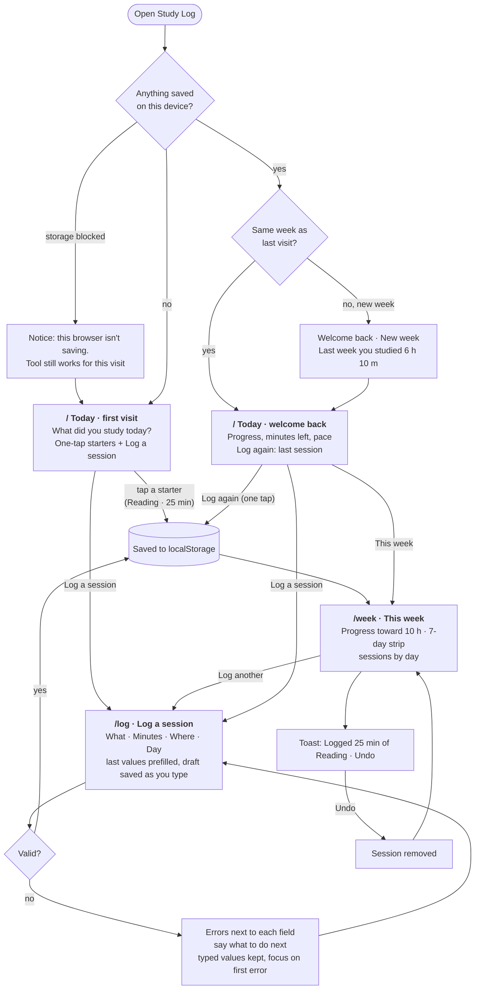

# Study Log

Log your study sessions and watch them add up toward a weekly goal. Built for MPCS 51238 Design, Build, Ship, Assignment 3 (Patterns & Flows).

**Live:** _deploying soon_ · **Style:** the Calm design system from [Assignment 2](https://study-spots-alpha.vercel.app/design-systems/calm)

## Who it's for

A university student who studies in cafés and libraries around campus and wants a simple answer to "Am I putting in enough hours this week?" Assignment 2 told you where to study; Study Log keeps track of how much you studied.

**Main task:** I log a study session → it counts toward my week → I come back on Thursday, and my progress is still there.

## Flows



Pages: `/` Today (first visit and coming back), `/log` Log a session, `/week` This week. More detail, including the states on each page, is in [flows.md](flows.md).

## How similar tools welcome someone new

Three subagents studied how these tools onboard a new user. Here's what we borrowed and what we left out.

| Tool | First screen | Time to something useful | Brings people back | What Study Log uses |
|---|---|---|---|---|
| **Streaks** (habit tracker) | Straight into "add a habit," with suggested habits. No account. | A few taps | Streak rings; a missed day resets to zero | One-tap starters on the first visit; a plain button with Undo instead of hold-to-complete; a 7-day strip that shows which days you studied |
| **Forest** (focus timer) | Five welcome slides, then the timer. Sign-up comes later. | About a minute, because of the slides | A growing forest, coins, and missions | No tour and no sign-up. Last course, minutes, and place are remembered so you don't start over each time. The empty week is shown as slots waiting to be filled. |
| **Toggl Track** (time tracker) | Sign-up questions, then a skippable tour | Press Play; every field is optional | Goals on the home screen, weekly emails | Weekly goal progress and pace lead the returning screen. Smart defaults, and Today/Yesterday shortcuts for the day field. Empty pages always offer a next step. |

Left out on purpose: sign-up questions, guided tours, and a getting-started checklist. Someone new should log something useful in one tap.

## Saved on this device

Everything lives in the browser's `localStorage` under `study-log:v1`. There are no accounts, database, or network calls. If the browser blocks storage, the tool still works for that visit and says it isn't saving.

## Accessibility

_To be filled in after the accessibility pass._

## First-run check

_To be filled in after deploy: an agent tries the live tool as a brand-new user._

## Run it

```bash
npm install
npm run dev     # http://localhost:3000
npm run build   # production build
```
