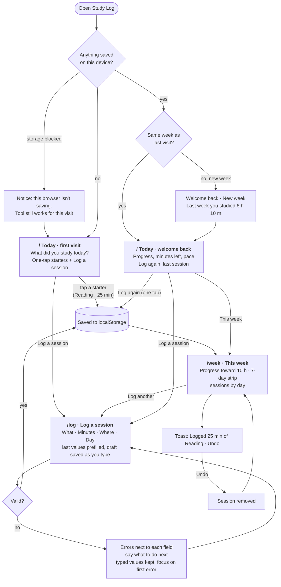

# Study Log flows

**Main task:** I log a study session → it counts toward my week → I come back on Thursday, and my progress is still there.

## States per page

| Page | Empty / first | Loading | Error | Success |
|---|---|---|---|---|
| `/` | Starters, empty 7-day strip as an invitation | Skeleton until storage is read | "Not saving" notice | Welcome back with progress |
| `/log` | Prefilled defaults | Skeleton | Field errors with next step | Redirect to `/week` with toast |
| `/week` | "No sessions this week yet" + Log a session | Skeleton | "Not saving" notice | Toast with Undo |
